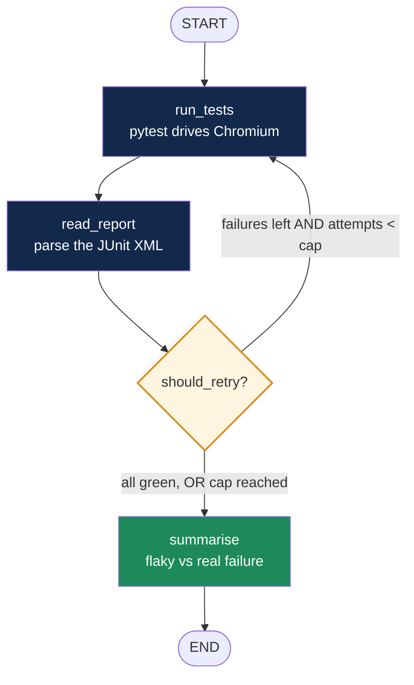
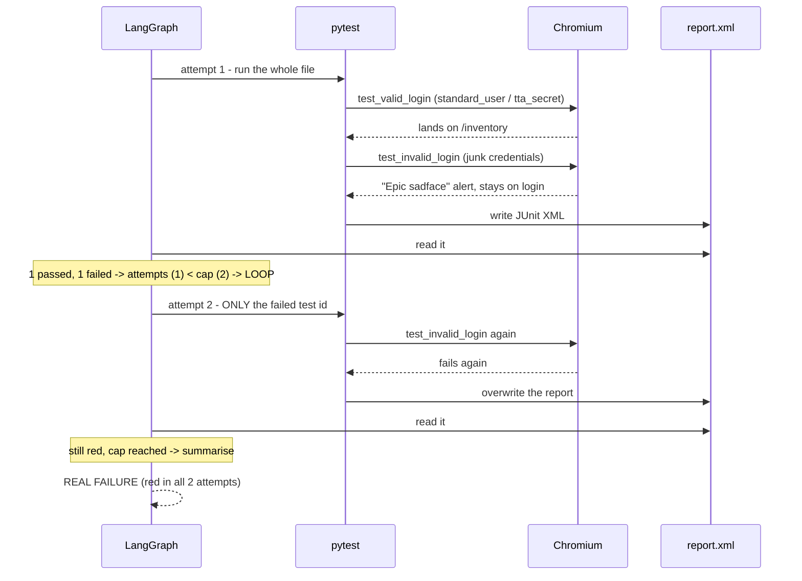
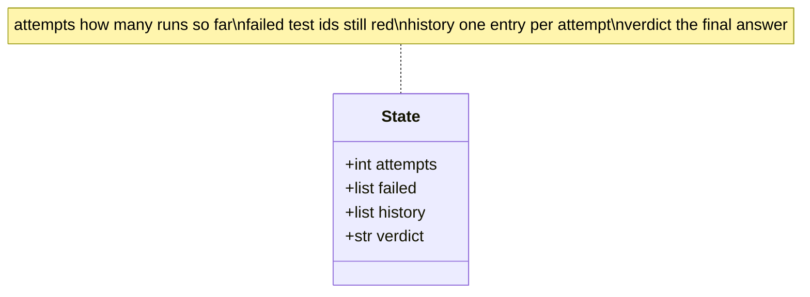

# Objective - the Playwright Flaky Finder

We already have a Playwright framework that gives us a result. For valid and
invalid test cases it reads that result, and based on the result it decides
whether it has to rerun or not.

That one sentence is the whole project. Everything below is how it is wired.

> The rendered hero image is still pending: this machine's Codex CLI cannot reach any
> model on its ChatGPT account. The brief is checked in at
> `images/flaky-finder-flow.brief.md`, ready to render once that is fixed.

## The problem

A red test tells you something broke. It does not tell you **what kind** of broken:

| | Behaviour | What it means | What to do |
|:--|:--|:--|:--|
| **Flaky** | fails, then passes on a rerun | a race, a slow network, a bad wait | fix the test |
| **Real failure** | fails every single time | the app is genuinely broken | fix the app |

You cannot tell them apart from one run. You need a second run, and a rule for
when to do one. That rule is the graph.

## The flow



The arrow from `should_retry?` back up to `run_tests` is the only unusual part.
A pipeline tool draws left to right and stops. A graph lets an edge point
backwards, and a backwards edge is a loop.

## What happens on a real run



## The state

Every node receives this dict and returns only the keys it changed. LangGraph
merges the rest.



| Node | Reads | Returns |
|:--|:--|:--|
| `run_tests` | `attempts`, `failed` | `attempts` |
| `read_report` | `attempts`, `history` | `failed`, `history` |
| `should_retry` | `failed`, `attempts` | *(a route, not state)* |
| `summarise` | `history`, `failed` | `verdict` |

## The two tests

Both live in `tests/test_login.py` and hit the real
[TTACart](https://app.thetestingacademy.com/playwright/ttacart/).

| Test | Credentials | Asserts | Outcome |
|:--|:--|:--|:--|
| `test_valid_login` | `standard_user` / `tta_secret` | lands on `/inventory` | **passes** |
| `test_invalid_login` | junk | lands on `/inventory` | **fails, always** |

The second one is designed to fail. Asserting success after a bad login gives
the loop something permanently red, so the `REAL FAILURE` branch is reachable in
a demo. Point it at something genuinely intermittent and you will see `FLAKY`
instead.

## Three decisions

**The report is the only evidence.** `run_tests` deliberately throws away
pytest's exit code; `read_report` parses the XML instead. That is the difference
between an agent reading a report and a shell script checking `$?`, and it is
where an LLM node would plug in later.

**Retries re-run only what failed.** Attempt 2 runs one test id, not the whole
file. It is what you would do by hand, and it keeps the loop fast.

**`--junitxml`, not a JSON reporter.** It ships with pytest, and `xml.etree` is
in the standard library. One less install in a classroom.

## Run it

```bash
cd chapter_18_LangGraph
.venv/bin/python3.13 src/Project_PW_FlakyFinder.py
```

```
-- attempt 1: pytest test_login.py
   PASS  test_valid_login[chromium]
   FAIL  test_invalid_login[chromium]

-- attempt 2: pytest test_login.py::test_invalid_login[chromium]
   FAIL  test_invalid_login[chromium]

VERDICT after 2 attempt(s)
REAL FAILURE  test_invalid_login[chromium]  (red in all 2 attempt(s))
STABLE PASS   test_valid_login[chromium]
```

`HEADED = True` watches the browser, `SLOW_MO_MS` makes it followable, and
`MAX_ATTEMPTS` is the cap. Use `.venv/bin/python3.13`, not `.venv/bin/python`:
the bare `python` in this venv is an Anaconda 3.12 that cannot see the 3.13
site-packages where pytest lives.